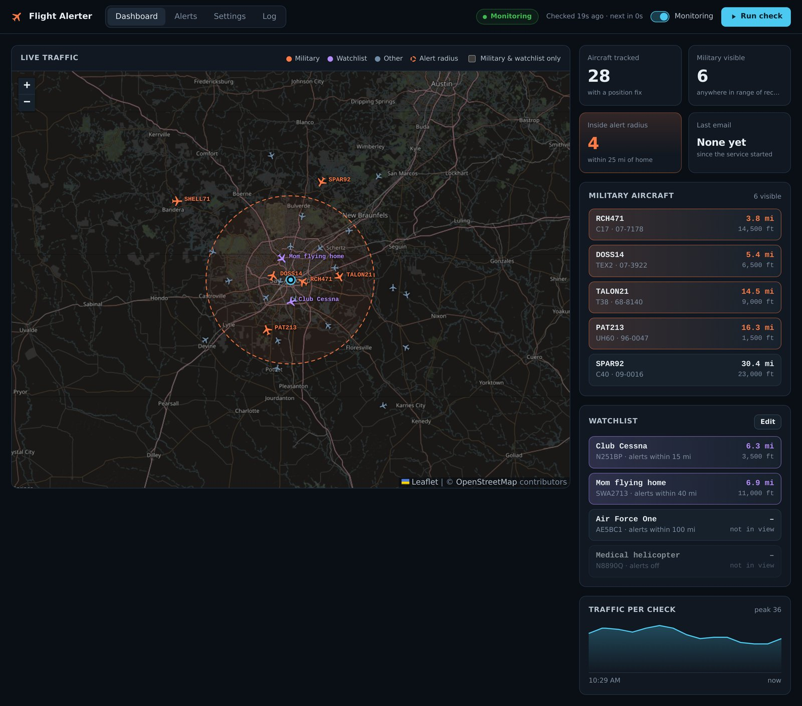
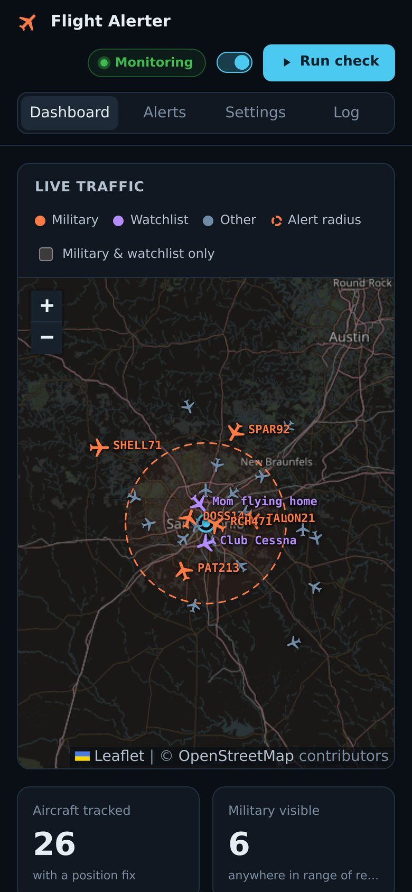
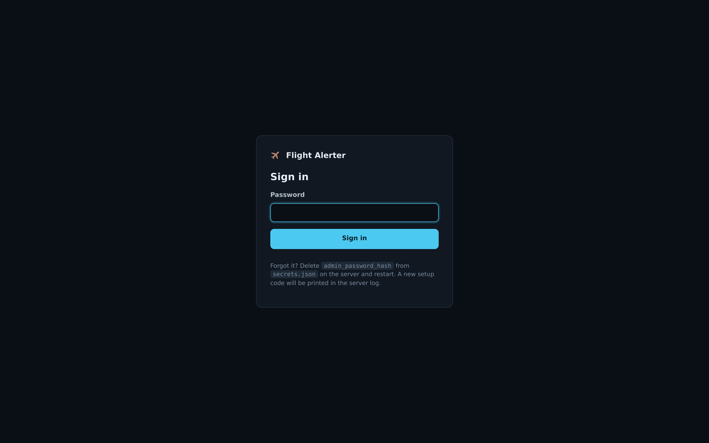
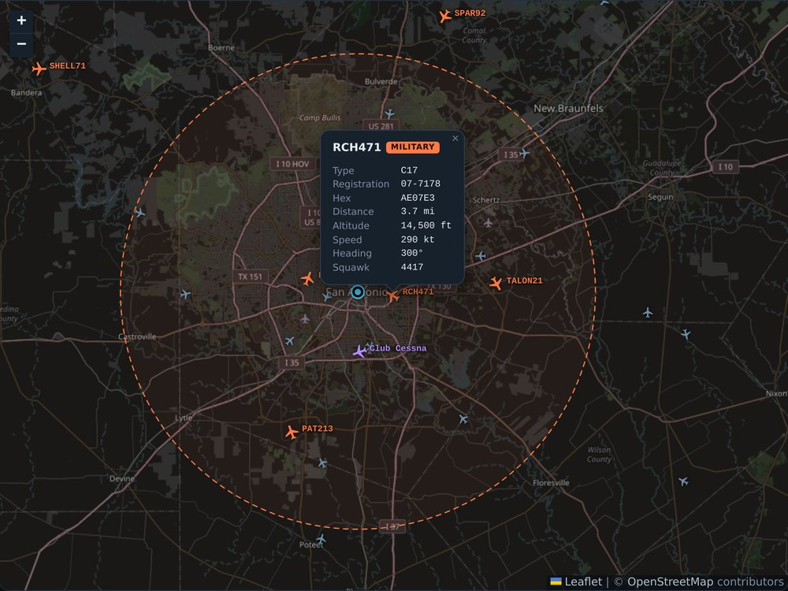
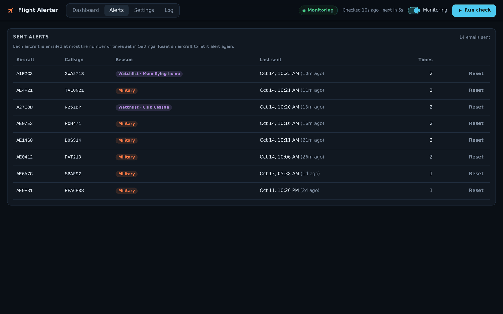
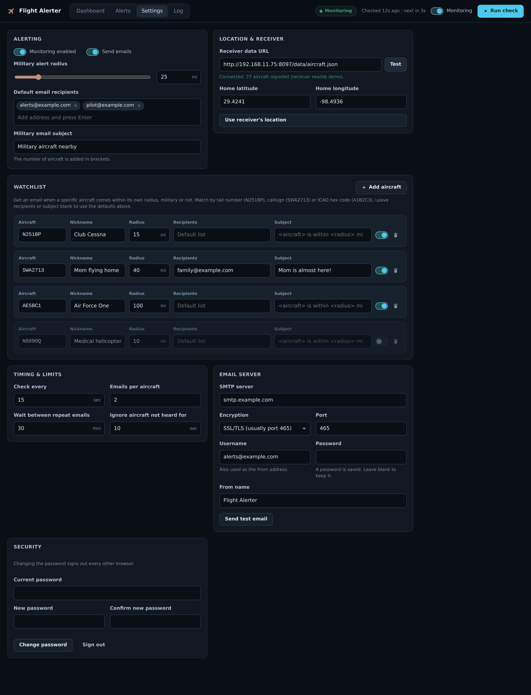
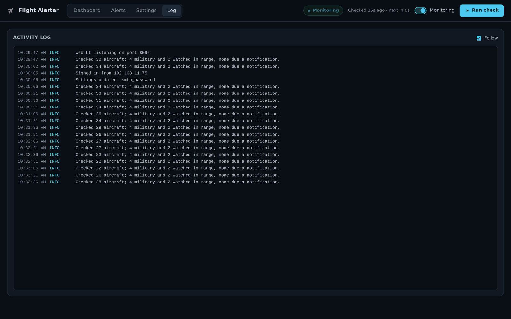

# flightAlerter

Sends an email when a military aircraft, or an aircraft on your watchlist, flies near
your location. It reads live positions from your own ADS-B receiver.



Every minute (configurable) it fetches `aircraft.json` from a SkyAware / tar1090 /
readsb receiver and sends email for:

- **Military aircraft** within the alert radius, in one summary email listing them by
  distance
- **Watchlist aircraft** within their own radius, one email per watchlist entry. Entries
  are matched by tail number, callsign or ICAO hex code, and can have their own
  recipients and subject. One entry can list several aircraft that share the same
  settings, such as every tail number a friend might fly.

Aircraft type and registration are looked up in the receiver's aircraft database. That
means a tail number on the watchlist is recognised even when the aircraft isn't
broadcasting it as its callsign.

A password-protected web dashboard (port 8095 by default) shows:

- a live map of traffic, with military and watchlist aircraft highlighted and the alert
  radius drawn
- status: last and next check, aircraft counts, last email, recent errors
- the history of sent alerts, with a button to reset any aircraft
- settings for everything, including the watchlist and the email server
- an activity log

It also works on a phone:



## Requirements

- An ADS-B receiver that serves `.../data/aircraft.json` and the matching `.../db/`
  aircraft database (SkyAware and tar1090 both do)
- An SMTP account that can send mail over SSL/TLS or STARTTLS (an app password is
  recommended)
- Docker with Docker Compose, or Python 3 to run it without Docker
- A browser with internet access for the dashboard map (tiles come from OpenStreetMap)

## Setup

1. Start the service (see [Running](#running)) and open `http://<host>:8095`.

2. Create the admin password (at least 8 characters). To prove you run the server, the
   page asks for a one-time setup code, which is printed in the server log. On a first
   install `./deploy.sh` prints it for you. Otherwise:

   ```sh
   docker compose logs flightalerter | grep "setup code"
   ```

   A new code is printed every time the service starts until a password is set.
   Afterwards the same page asks only for the password:

   

3. Fill in the **Settings** page: receiver URL, home location, recipients, email server,
   watchlist. Use **Send test email** to check the email settings.

Nothing else is required. See [Optional `.env` file](#optional-env-file) for changing
the port or running behind HTTPS.

## Running

With Docker:

```sh
./deploy.sh            # build, restart, wait until the dashboard answers
./deploy.sh --pull     # git pull first
./deploy.sh --logs     # follow the logs afterwards
./deploy.sh --down     # stop and remove the container (settings and history are kept)
```

`deploy.sh` runs `docker compose build` and `docker compose up -d`, which you can also
run yourself. Compose needs a `.env` file to exist, even an empty one; `deploy.sh`
creates it if it is missing.

The container runs the code built into the image. Settings, secrets and alert history
are kept in the `data/` folder here (mounted into the container at `/data`), so they
survive rebuilds. The service runs as the owner of `data/`, never as root: if root owns
it, `deploy.sh` hands it to user ID 1000. Older versions kept these files in this folder
itself; `deploy.sh` moves them into `data/`. If you run `docker compose` yourself, make
sure `data/` exists and is owned by user 1000.

`data/` is ignored by git, so `git clean -x` deletes it. Set `DATA_PATH` in `.env` to
keep it somewhere else.

Without Docker, run it from this folder (settings and history are kept in `data/` next
to the code, or in `DATA_DIR` if you set it):

```sh
python3 -m venv venv
venv/bin/pip install -r requirements.txt
venv/bin/python app.py
```

`.env` is not read when running without Docker; export any of its variables in the
shell instead. `venv/bin/python flightAlerter.py` runs a single check, sending any
emails that are due, without the web server.

## Optional `.env` file

Docker Compose reads `.env` from this folder. All of it is optional:

| Variable | Effect |
|----------|--------|
| `WEB_PORT` | Dashboard port (default 8095). The only way to change it. |
| `WEB_HTTPS` | Set to `1` when the dashboard is served over HTTPS by a reverse proxy, so the login cookie is only sent over HTTPS. |
| `WEB_PASSWORD` | Initial admin password, used instead of the setup code. Ignored once a password exists. |
| `DATA_PATH` | Folder for settings, secrets and alert history (default `./data`). |
| `SMTP_HOSTNAME`, `SMTP_PORT`, `SMTP_USERNAME`, `SMTP_PASSWORD`, `SMTP_FROM_NAME`, `HOME_LAT`, `HOME_LON`, `AIRCRAFT_DATA_URL` | Pre-fill settings on the very first start only. After that, change them in the dashboard. |

`.env.example` lists them all. Keep the file private (`chmod 600 .env`). Once the
service has started, delete `SMTP_PASSWORD` and `WEB_PASSWORD` from it: they have been
saved in `data/secrets.json` and are no longer read.

## Using the dashboard

Open `http://<host>:8095` and sign in.

### Top bar

- **Status pill**: *Monitoring* (all good), *Checking…*, *Paused*, *Error*,
  *Starting…* (no check yet), *Stalled* (checks have stopped running) or *Offline* (the
  browser lost contact with the service). Next to it: when the last check ran and when
  the next one is due.
- **Monitoring** switch: pauses or resumes the regular checks straight away, without
  touching other settings. While paused, no scheduled checks run and no email is sent.
- **Run check**: runs a check now, even while paused. Any email that is due is sent, so
  this is a quick end-to-end test once the settings are filled in.
- A red banner under the bar shows what went wrong in the last check, for example an
  unreachable receiver or an email that could not be sent. One failed email doesn't stop
  the others; it is tried again at the next check.

### Dashboard

- **Live traffic** map, updated every few seconds. Orange is military, purple is a
  watchlist aircraft, grey-blue is everything else. The dashed circle is the military
  alert radius around your home location. Click an aircraft for its type, registration,
  hex code, distance, altitude, speed, heading and squawk. **Military & watchlist only**
  hides other traffic.

  
- **Stat cards**: aircraft on the map (with a position fix), military aircraft anywhere
  in receiver range, military aircraft inside the alert radius, and when the last email
  went out. If that card says *Emails off* or *Not set up*, see Settings.
- **Military aircraft** lists the military aircraft in view, nearest first. Items inside
  the radius are highlighted. Click one (or select it and press Enter) to fly the map to
  it.
- **Watchlist** shows each watchlist entry and whether it is in view. For an entry listing
  several aircraft, it names the nearest one in view. Click one in view to find it on the
  map. **Edit** jumps to the watchlist in Settings.
- **Traffic per check** charts how many aircraft each recent check saw. Hover for the
  exact count. It starts empty after a restart.

### Alerts

One row per aircraft and reason (military, or a watchlist entry), newest first. An
aircraft that was emailed both as military and as a watchlist match has two rows. Each
row shows the callsign, when the last email was sent and how many have been sent.
**Reset** clears that row's history so the aircraft can alert again, for example after
you raise the per-aircraft limit or want a fresh email the next time it passes.



### Settings

Changes are not applied until you press **Save settings** in the bar that appears at
the bottom. **Discard** puts the form back to the saved values. Fields with problems are
marked in red, and nothing is saved until they are fixed. Saving runs a check straight
away when monitoring is on.



- **Alerting**: monitoring on/off (same as the top-bar switch), **Send emails** (turn
  off to watch the dashboard without sending mail), the military alert radius, default
  recipients (type an address and press Enter or comma; click × to remove one) and the
  military email subject (`<aircraft>` and `<radius>` are filled in here too).
- **Location & receiver**: the receiver's `aircraft.json` URL. **Test** checks that it
  answers and shows how many aircraft it reports. **Use receiver's location** fills in
  home latitude and longitude from the receiver, if it publishes them. Save afterwards.
- **Watchlist**: **Add aircraft**, then enter a tail number (`N251BP`), callsign
  (`SWA2713`) or ICAO hex code (`A1B2C3`). To give several aircraft the same settings,
  list them in one entry separated by commas (`N324FX, N268FX, N335FX`, up to 50).
  Optional nickname, radius, recipients and subject per entry. Blank recipients use the
  default recipients. In the subject, `<aircraft>` is replaced by the aircraft the email
  is about and `<radius>` by the entry's radius, so `Jim might be within <radius> mi in
  <aircraft>` becomes "Jim might be within 40 mi in N268FX". A blank subject becomes
  "*nickname* is within *N* mi", or "*aircraft* is within *N* mi" without a nickname.
  Untick an entry to pause it without deleting it.
- **Timing & limits**: how often to check, emails per aircraft, the wait between repeat
  emails, and how old an aircraft's position can be before it no longer triggers alerts.
- **Email server**: SMTP host, encryption (SSL/TLS, usually port 465, or STARTTLS,
  usually 587), port, username (also the From address), password and From name. The
  password is never shown; leave the field blank to keep the saved one. **Send test
  email** sends to the default recipients using the saved settings, so save first.
- **Security**: change the admin password (signs out every other browser) or sign out.

### Log

The service's recent activity: checks, emails sent, settings changes, sign-ins and
errors. **Follow** keeps the newest line in view. It holds the last 300 lines and is
cleared on restart; `docker compose logs flightalerter` has the full history.



### Troubleshooting

| You see | What to do |
|---------|------------|
| *Receiver URL is not set* / *Could not reach the receiver* | Settings → Location & receiver: fix the URL, then **Test**. |
| *Home location is not set* | Settings → Location & receiver: enter your latitude and longitude, or **Use receiver's location**, then save. |
| *Could not send 1 email: …* | Check Settings → Email server and the recipients, then **Send test email**. |
| *Stalled* | Checks have stopped running. Restart with `./deploy.sh` and check `docker compose logs flightalerter` for the error. |
| Last email: *Not set up* | Fill in Settings → Email server, save, then **Send test email**. |
| An aircraft in range but no email | Check the Alerts page: it may have hit its email limit or still be in the wait between repeats. **Reset** it there. Also check that **Send emails** is on. |
| Map tiles say *Access blocked* | Hard-refresh the page (Ctrl+Shift+R). OpenStreetMap refuses some requests; see its tile usage policy. |
| *Offline* | The browser can't reach the service. Check it is running: `./deploy.sh`, or `docker compose logs flightalerter` for errors. |

## Files

Kept in `data/` (`/data` inside the container):

| File               | Contents                                                    | In git? |
|--------------------|-------------------------------------------------------------|---------|
| `settings.json`    | All settings except passwords                               | No      |
| `secrets.json`     | SMTP password, admin password hash, session signing key     | No      |
| `sentAlerts.csv`   | Which aircraft have been emailed, and when                  | No      |
| `.env`             | Optional, see [above](#optional-env-file)                   | No      |

`militaryFlights.csv` and `monitoredFlights.csv` are config files from older versions.
If they are in `data/` when `settings.json` isn't, their values are imported into the
settings and the watchlist. After that they are ignored.

## Security

- **Login.** Every page and API call needs a login. The admin password is stored only
  as a salted PBKDF2 hash. Sessions use an HttpOnly, SameSite=Strict cookie and last
  30 days.
- **Changing the password** signs out every other browser. Signing out only clears the
  cookie in that browser, so change the password if you think a session was stolen.
- **Wrong passwords.** After 5 wrong attempts (login, setup code or current password),
  that address is refused for 15 minutes. Attempts are counted as they arrive, so sending
  many at once doesn't get around the limit. Behind a reverse proxy every visitor shares
  the proxy's address, so they are locked out together.
- **Forged requests.** Every request that changes something must carry a custom header,
  which blocks cross-site request forgery. Pages are sent with a strict Content Security
  Policy and can't be embedded in frames.
- **SMTP password.** It's write-only in the UI: it is never sent back to the browser or
  written to the log. It's stored in plain text in `secrets.json`, which only its owner
  can read.
- **Certificates.** Email is sent over TLS, and the mail server's certificate is
  verified.
- **Container.** The service runs as an unprivileged user and can only write to `data/`.
  The map library is loaded from a CDN with an integrity hash, so a tampered copy is
  refused.
- **HTTPS.** The dashboard itself speaks plain HTTP. Keep it on your LAN. To reach it
  from outside, put it behind a reverse proxy with HTTPS and set `WEB_HTTPS=1` so the
  session cookie is only sent over HTTPS.

**Forgot the admin password?** In `data/secrets.json`, change the value of
`admin_password_hash` to `""` and restart (`docker compose restart`). A new setup code
is printed in the log. If `WEB_PASSWORD` is still set in `.env`, it becomes the password
instead.

## How aircraft are classified as military

An aircraft counts as military if any of these is true:

- The receiver database marks it military (`dbFlags` lowest bit set, or
  `military: true`)
- Its operator field contains one of the words `AIR FORCE`, `USAF`, `NAVY`,
  `MARINE CORPS`, `USMC`, `ARMY`, `COAST GUARD`, `RAF` or `LUFTWAFFE` (as whole words, so
  `AIRCRAFT GUARANTY CORP` is not mistaken for the RAF)
- Its callsign is a known military prefix followed by digits (`RCH`, `REACH`, `PAT`,
  `SPAR`, and others)

To keep checks fast, the database lookup is skipped for aircraft outside every alert
radius (they can't trigger an email anyway), so those are classified from the
receiver's own data only. The dashboard map always looks them up.

Only aircraft whose position is less than 10 seconds old (configurable) can trigger an
email; the map and counts include positions up to a minute old.

## Alert limits

Sent alerts are logged in `sentAlerts.csv`. By default each aircraft triggers at most
two emails, more than 30 minutes apart; both limits can be changed in Settings. Military
alerts and each watchlist entry are counted separately. To let an aircraft alert again,
reset it on the **Alerts** page.

While **Send emails** is off, nothing is recorded, so aircraft still in range alert
once emails are turned back on.

## Development

The tests use only Python's standard library. Run them in the image:

```sh
docker compose build
docker compose run --rm --no-deps flightalerter python -m unittest discover -s tests -t .
```

or, without Docker, `venv/bin/python -m unittest discover -s tests -t .` from this folder.

Dependencies are pinned in `requirements.txt`. To upgrade, change the versions there,
rebuild and run the tests.

## Releases

The version number is in the `VERSION` file ([Semantic Versioning](https://semver.org));
the dashboard shows it next to the name. [CHANGELOG.md](CHANGELOG.md) lists what changed.

To make a release: update `VERSION` and `CHANGELOG.md`, commit, then tag and publish:

```sh
git tag -a v1.1.0 -m "v1.1.0"
git push origin v1.1.0
gh release create v1.1.0 --title "v1.1.0" --notes-file <(sed -n '/^## 1.1.0/,/^## /p' CHANGELOG.md | sed '$d')
```

To update an install to a release: `git fetch --tags && git checkout v1.1.0 && ./deploy.sh`.
